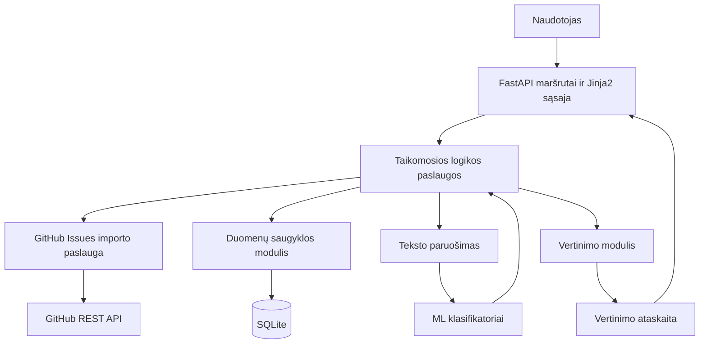

# Sistemos architektūra

## 1. Architektūros tikslas ir ribos

Projektas yra individualaus bakalauro darbo prototipas, skirtas ištirti, ar iš GitHub issue pavadinimo ir aprašymo galima automatiškai pasiūlyti programinės įrangos klaidos kategoriją, sudėtingumą ir prioritetą.

Pirmoji versija:
- importuoja viešos GitHub repozitorijos issues tik skaitymo režimu;
- leidžia peržiūrėti importuotus įrašus ir rankiniu būdu patvirtinti mokymo žymas;
- paruošia tekstą ir mokymo duomenis;
- atskirai prognozuoja kategoriją, sudėtingumą ir prioritetą;
- rodo rezultatą, prognozės metodą, pasitikėjimo įvertį ir duomenų pakankamumo būseną;
- pateikia modelio vertinimo ataskaitą;
- saugo duomenis lokaliai SQLite faile.

Pirmoji versija sąmoningai **nepriskiria atsakingo programuotojo**, nekeičia GitHub issues, nerašo į GitHub API, nenaudoja mokamos LLM API, netreniruoja milžiniško neuroninio tinklo ir neturi mikroservisų ar atskiro JavaScript SPA.

## 2. Siūlomas technologijų rinkinys

| Sritis | Pasirinkimas | Kodėl |
|---|---|---|
| Kalba | Python 3.12+ (ar naujausias aplinkoje palaikomas Python) | Teksto analitika, ML biblioteka, paprastas prototipavimas |
| Web/API | FastAPI | Maršrutai, įvesties validacija, automatiškai aprašoma API |
| HTML | Jinja2 serverio pusės šablonai, paprastas CSS | Nereikia atskiro frontend build proceso |
| Duomenų bazė | SQLite, Python `sqlite3` | Be serverio ir atskiros DB instaliavimo |
| ML | scikit-learn: `TfidfVectorizer` + `LogisticRegression` | Aiškus, lengvai atkuriamas teksto klasifikavimo pradinis modelis |
| GitHub integracija | GitHub REST API per `httpx` | Viešų issue importas, laiko limitai ir klaidų tvarkymas |
| Testai | pytest + FastAPI TestClient | Vienetiniai ir integraciniai testai |
| Konfigūracija | Aplinkos kintamieji ir vienas konfigūracijos modulis | Nėra slaptažodžių kode |

Nenaudoti React, Node.js, Docker, Redis, Celery, vektorinių DB, LLM API, ORM ir papildomų infrastruktūros sluoksnių, kol nėra konkretaus reikalavimo. SQLite prieiga kapsuliuojama atskirame modulyje; SQL užklausos parametrizuojamos.

## 3. Komponentų architektūra



### Atsakomybės

1. **Sąsaja / FastAPI maršrutai** – priima naudotojo veiksmus, validuoja formas, pateikia HTML puslapius ir JSON API atsakymus. Čia negali būti ML algoritmo ar SQL užklausų.
2. **GitHub importo paslauga** – gauna issues puslapiais, apdoroja HTTP klaidas, laiko limitus ir rate limit situacijas, ignoruoja pull request įrašus.
3. **Teksto paruošimas** – saugiai sujungia pavadinimą ir aprašymą, normalizuoja trūkstamą tekstą, nekeičia originalaus įrašo; mokymo/testavimo duomenų skirstymas atliekamas prieš mokymo metu išmokstamą požymių transformaciją.
4. **Anotavimo paslauga** – leidžia žmogui parinkti kategoriją, sudėtingumą bei prioritetą. Vien etiketės pavadinimas automatiškai nelaikomas patikima žyma, nebent yra aiški naudotojo patvirtinta etikečių žemėlapių konfigūracija.
5. **Klasifikavimo paslauga** – atskirai treniruoja ir vykdo prognozę kiekvienam laukui. Modelis mokomas tik iš žmogaus patvirtintų, atitinkamą žymą turinčių įrašų.
6. **Duomenų saugykla** – atlieka SQLite įterpimus, atnaujinimus ir užklausas, bet neturi sprendimų dėl verslo logikos.
7. **Vertinimo modulis** – generuoja mokymo/vertinimo ataskaitas neįtraukdamas testinių žymų į mokymą ir pateikia klasifikavimo metrikas.
8. **Konfigūracija** – saugo DB kelią, GitHub tokeno aplinkos kintamojo pavadinimą ir ML slenksčius; paslaptys neišsaugomos repo.

## 4. Siūloma katalogų struktūra

```text
Bakalauras/
├── app/
│   ├── main.py                  # FastAPI programos kūrimas
│   ├── config.py                # Konfigūracija ir aplinkos kintamieji
│   ├── db.py                    # SQLite prisijungimai, schema ir transakcijos
│   ├── routes/
│   │   ├── dashboard.py         # Pradinis puslapis ir statistika
│   │   ├── issues.py            # Importas, sąrašas ir detalės
│   │   ├── annotations.py       # Žymų tvirtinimas
│   │   ├── predictions.py       # Prognozavimas ir rezultatai
│   │   └── evaluation.py        # Vertinimo ataskaitos
│   ├── services/
│   │   ├── github_client.py     # Tik skaitymo GitHub REST klientas
│   │   ├── import_service.py    # Importo ir dublikatų logika
│   │   ├── annotation_service.py
│   │   ├── text_preprocessing.py
│   │   ├── training_service.py
│   │   ├── prediction_service.py
│   │   └── evaluation_service.py
│   ├── ml/
│   │   ├── classifier.py        # Pipeline kūrimas, treniravimas, prognozės
│   │   └── model_registry.py    # Vietinių modelių versijos / metaduomenys
│   ├── templates/               # Jinja2 HTML
│   └── static/
│       └── styles.css
├── tests/
│   ├── test_preprocessing.py
│   ├── test_github_client.py
│   ├── test_import_service.py
│   ├── test_annotations.py
│   ├── test_classifier.py
│   ├── test_evaluation.py
│   └── test_routes.py
├── data/
│   └── .gitkeep                 # DB ir eksportuoti duomenys nėra committinami
├── models/
│   └── .gitkeep                 # Modelio failai nėra committinami pagal nutylėjimą
├── docs/
│   ├── IMPLEMENTATION_PLAN.md
│   ├── EVALUATION_PLAN.md
│   └── DATA_LABELING.md
├── .env.example
├── .gitignore
├── CLAUDE.md
├── README.md
└── requirements.txt
```

Tai loginė struktūra, ne reikalavimas nuo pirmos dienos sukurti kiekvieną modulį. Kurti katalogus ir failus tik tame etape, kuriam jie reikalingi. Nevertėtų failų skaidyti smulkiau be naudos.

## 5. Duomenų modelis

### `issues`

| Laukas | Paskirtis |
|---|---|
| `id` | Vidinis pirminis raktas |
| `repository_full_name` | GitHub formato savininkas/repozitorija |
| `issue_number` | Issue numeris konkrečioje repozitorijoje |
| `title`, `body` | Originalus tekstas |
| `state`, `html_url` | Būsena ir nuoroda |
| `labels_json` | Originalios GitHub etiketės JSON formatu |
| `github_created_at`, `github_updated_at` | GitHub datos |
| `is_pull_request` | PR indikacija; PR neįtraukiamas į klaidų datasetą |
| `imported_at` | Paskutinio importo laikas |
| `category_label` | Patvirtinta kategorija arba NULL |
| `complexity_label` | Patvirtintas sudėtingumas arba NULL |
| `priority_label` | Patvirtintas prioritetas arba NULL |
| `annotation_source`, `annotated_at` | Žymos kilmė ir laikas |

Unikalus apribojimas: `(repository_full_name, issue_number)`. Importuojant tą patį issue atnaujinti šaltinio metaduomenis, bet **neperrašyti žmogaus patvirtintų žymų**.

### `prediction_runs`

Saugoti prognozės istoriją (issue ID, laukas, prognozuota reikšmė, confidence jei prieinamas, metodas, modelio versija, sukūrimo laikas ir statusas). Prognozė niekada neperrašo žmogaus patvirtintos žymos.

### `model_versions`

Saugoti lauką, modelio versijos identifikatorių, treniravimo datą, treniravimo įrašų skaičių, klasių pasiskirstymą ir metrikų santrauką. Nelaikyti testinių žymų kaip modelio mokymo duomenų.

SQLite schema turi būti aiški ir paprasta. Visi SQL parametrai turi būti bind'inami; neįterpti naudotojo teksto į SQL eilutes. Kiekvienas DB veiksmas užtikrina transakcijos užbaigimą arba rollback.

## 6. GitHub importas

- Naudotojas įveda viešos repozitorijos `owner/repo` pavadinimą arba patikrintą GitHub URL.
- Klientas naudoja GitHub REST API issues endpointą su paginacija.
- Pull request atpažįstamas pagal `pull_request` objektą ir praleidžiamas.
- Nenaudoti neriboto atsisiuntimo; turėti importo limitą, puslapio dydžio limitą ir aiškų klaidos pranešimą.
- Išsaugoti originalų `title`, `body`, labels, state, URL ir laiko žymas.
- Pakartotinis importas yra idempotentiškas.
- Viešoms repozitorijoms tokenas nebūtinas, bet aplinkos `GITHUB_TOKEN` gali būti naudojamas rate limit pagerinti.
- Joks endpointas neturi keisti issue, label ar assignee GitHub pusėje.
- Priimti tik `github.com` HTTPS URL / normalizuotą `owner/repo`, apsaugoti nuo SSRF ir neleidžiamų hostų. Nenaudotojo pateikto arbitrary URL serverio užklausa nevykdoma.
- Nurodyti importo apribojimus, API klaidas, 403/404 ir rate limit būsenas; nedėti tokeno į logus.

## 7. Kategorijos, sudėtingumas ir prioritetas

Numatytos pradinės etikečių reikšmės turi būti konfigūruojamos, o ne išsibarsčiusios kode.

- **Kategorija:** `ui`, `backend_api`, `database_data`, `security`, `performance`, `build_deployment`, `documentation`, `other`.
- **Sudėtingumas:** `low`, `medium`, `high`. Apibrėžti pagal laukiamą analizės, pakeitimų ir testavimo apimtį, o ne pagal teksto ilgį.
- **Prioritetas:** `P0_critical`, `P1_high`, `P2_medium`, `P3_low`. Vadovautis poveikiu naudotojams/sistemai, apimtimi, duomenų saugumu ir galimais apėjimo būdais. Pateikti aiškias anotavimo gaires.

Kiekvienam laukui atskiras klasifikatorius, nes įraše gali būti žinoma viena žyma, bet nežinomos kitos. Jei duomenų nepakanka mokymui, rodyti `insufficient_data`, o ne apsimesti, kad yra modelio prognozė. Taisyklių pasiūlymas gali būti įjungiamas tik kaip aiškiai atskirtas `rule_based_suggestion`, su paaiškinimu ir be teiginio, kad jis validuotas ML rezultatas.

Pradinis modelis: `Pipeline(TfidfVectorizer(...), LogisticRegression(...))`. Teksto įvestis: issue title + body. Modelį fit'inti tik mokymo split'e. Tokenizavimą, žodyną ir kitus požymius mokyti tik naudojant treniravimo duomenis. Išsaugoti modelio metaduomenis; naudoti deterministinį random seed. Sudėtingesnį modelį svarstyti tik palyginus su šia baze ir dokumentavus priežastį.

**Confidence ribos:** `predict_proba` reikšmė nėra savaime patikimumo garantija. Sąsajoje rodyti ją kaip modelio įvertį, o ne kalibruotą tikimybę, jei kalibracija nepatikrinta. Žemą vertę turinčias prognozes galima žymėti peržiūrai, slenkstį nustatant pagal validavimo duomenis.

## 8. Pagrindiniai naudotojo scenarijai

1. Atidaryti dashboard ir matyti importuotų issues / pažymėtų issues skaičių.
2. Įvesti viešą GitHub repozitoriją ir importuoti ribotą skaičių issues.
3. Peržiūrėti issue su pavadinimu, aprašymu, GitHub etiketėmis ir nuoroda.
4. Rankiniu būdu patvirtinti kategoriją, sudėtingumą ir prioritetą; galima pažymėti lauką kaip nežinomą.
5. Paleisti kiekvieno tinkamo lauko modelio mokymą.
6. Prognozuoti pasirinktą issue ir pamatyti rezultatą, metodą, modelio versiją ir peržiūros indikatorių.
7. Atidaryti vertinimo puslapį ir pamatyti metrikas, duomenų kiekį, klasių balansą bei apribojimus.
8. Eksportuoti anotacijų / vertinimo santrauką CSV formatu, jei tai padeda tyrimui.

## 9. Nefunkciniai reikalavimai

- Įprastas vietinis paleidimas vienu serverio procesu.
- Pakartojamas modelio treniravimas su fiksuotu seed ir išsaugotais duomenų skirstymo parametrais.
- Neiškelti paslapčių, didelių DB/modelių failų ir privačių issue aprašymų į Git.
- Forma ir API validuoja laukus bei pateikia suprantamus klaidų pranešimus.
- Automatiniai testai nenaudoja gyvo GitHub tinklo; naudoja užmock'intus HTTP atsakymus.
- Gyvo GitHub importo testas vykdomas atskirai kaip rankinis dūmų testas.
- Modelio ataskaita turi atskirti validuotus rezultatus nuo pavyzdinių taisyklių.
- Minimalūs prieinamumo principai: semantinis HTML, label laukams, tinkamas kontrastas, aiškus klaidų tekstas.

## 10. Rizikos ir jų valdymas

| Rizika | Valdymas |
|---|---|
| Per mažai patikimų žymų | Rankinis anotavimas, duomenų pakankamumo indikatorius, nėra netikro accuracy |
| GitHub labels nesuderintos su tyrimo kategorijomis | Konfigūruojamas žemėlapis ir žmogaus patvirtinimas |
| Klasių disbalansas | Rodyti pasiskirstymą, naudoti macro-F1 ir confusion matrix |
| Duomenų nutekėjimas | Duomenų split prieš modelio fit; pipeline tik mokymo split'e |
| API rate limits | Paginacija, ribotas importas, aiškūs klaidų pranešimai, pasirenkamas tokenas |
| Per didelė darbų apimtis | Nėra assignee rekomendavimo ir išorinių LLM pirmoje versijoje |
| Netiksliai interpretuojamas confidence | Aiškiai žymėti kaip score; kalibruoti tik atskirai įvertinus |

## 11. Architektūros priėmimo kriterijai

- Galima importuoti viešos repozitorijos issues ir neimportuoti PR.
- Pakartotinis importas nesukuria dublikatų ir neperrašo anotacijų.
- Galima rankiniu būdu pažymėti kiekvieną iš trijų laukų nepriklausomai.
- ML modelis nedirba, kol nėra pakankamai patvirtintų duomenų; trūkumo būsena rodoma aiškiai.
- Mokymo ir vertinimo duomenys atskirti; testų žymos nepatenka į modelio fit.
- Rodomos bent precision, recall, F1, macro-F1, confusion matrix ir duomenų kiekis, kai vertinimas galimas.
- Testai praeina be gyvo tinklo ir be išorinių AI API.
- README aprašo paleidimą, konfigūraciją ir žinomus apribojimus.
