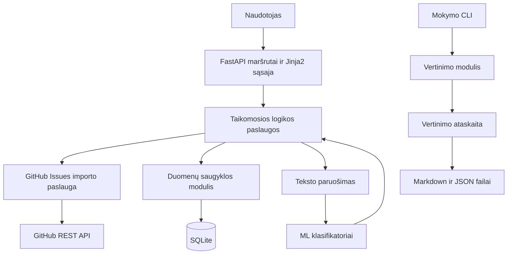

# Sistemos architektūra

## Dabartinė realizacija (5D baigta) ir naujas 6 etapo planas (2026-11-27)

0–5D etapai baigti, PR #11 sujungtas į main. Modelių versija `20261113-125330`. 6 etapo reikalavimai aptarti su darbo vadovu ir pasirinkta vienos organizacijos kryptis. **6A įgyvendintas šakoje `claude/phase-6a-user-accounts`** (žr. 13 skyrių „6A – įgyvendinta“); 6B–6E dar neįgyvendinti. Statistikos puslapis nėra privalomas. P0 paliekamas, nors jo atpažinimas silpnas.

- 40 024 importuoti GitHub įrašai; 23 884 sėkmingos DI anotacijos (19 412 tinkamų, 4 472 netinkamų).
- 18 267 mokymo ir validacijos pavyzdžiai; 1 120 atrinktų testo įrašų, iš jų 901 tinkamas (visi 901 su DI etalonu); 30 pilotinių įrašų.
- 243 artimi testo dublikatai pašalinti iš mokymo. Bendra DI žymėjimo kaina 4,5948 USD.
- Trys apmokyti modeliai ir jų ataskaitos saugomi GitHub; SQLite DB, jos kopijos, .env ir .venv – tik lokaliai.
- Testo accuracy / macro-F1: kategorija 64,26 % / 62,22 %; sudėtingumas 69,70 % / 69,14 %; prioritetas 65,93 % / 48,20 %. P0 F1 = 0. Metrikos rodo atitikimą Claude žymoms, ne nepriklausomai žmogaus patvirtintai tiesai. Ankstesnio ir naujo modelio metrikos iš skirtingų testų nėra tiesiogiai palyginamos.

## 1. Architektūros tikslas ir ribos

Projektas yra individualaus bakalauro darbo prototipas – nedidelė internetinė programinės įrangos klaidų registravimo ir valdymo sistema su automatiniu teksto klasifikavimo moduliu. Ji turi dvi sąsajos dalis: viešą klaidos pranešimo formą klientui / testuotojui ir vidinę, prisijungimu apsaugotą programuotojo / klaidų koordinatoriaus aplinką. ML tyrimui atskirai importuojami vieši GitHub Issues įrašai.

Pirmoji versija:
- leidžia klientui / testuotojui be paskyros pateikti klaidos aprašymą viešoje formoje;
- išsaugo pateiktą klaidą ir automatiškai bando nustatyti kategoriją, prioritetą bei, jei duomenų pakanka, sudėtingumą;
- leidžia programuotojui / koordinatoriui prisijungti prie vidinės aplinkos, peržiūrėti visas klaidas, filtruoti ir ieškoti įrašų;
- leidžia keisti klaidos būseną (`new`, `in_progress`, `resolved`) ir išsaugoti ištaisytų klaidų istoriją;
- leidžia programuotojui pataisyti neteisingą automatinę prognozę; žmogaus patvirtinta žyma laikoma atskirai nuo modelio prognozės;
- importuoja viešos GitHub repozitorijos issues tik skaitymo režimu;
- leidžia peržiūrėti importuotus įrašus ir rankiniu būdu patvirtinti mokymo žymas;
- paruošia tekstą ir mokymo duomenis;
- atskirai prognozuoja kategoriją, sudėtingumą ir prioritetą;
- rodo rezultatą, prognozės metodą, pasitikėjimo įvertį ir duomenų pakankamumo būseną;
- pateikia modelio vertinimo ataskaitą;
- saugo duomenis lokaliai SQLite faile.

Esama 5D versija sąmoningai **nepriskiria atsakingo programuotojo**, nekeičia GitHub issues, nerašo į GitHub API, svetainėje nenaudoja mokamos LLM API (ji naudojama tik vienkartiniam mokymo duomenų žymėjimui atskirais scenarijais, žr. 5 skyriaus `ai_annotations`), netreniruoja milžiniško neuroninio tinklo ir neturi mikroservisų ar atskiro JavaScript SPA.

## 2. Naudojamas technologijų rinkinys

| Sritis | Pasirinkimas | Kodėl |
|---|---|---|
| Kalba | Python 3.12+ (ar naujausias aplinkoje palaikomas Python) | Teksto analitika, ML biblioteka, paprastas prototipavimas |
| Web/API | FastAPI | Maršrutai, įvesties validacija, automatiškai aprašoma API |
| HTML | Jinja2 serverio pusės šablonai, paprastas CSS | Nereikia atskiro frontend build proceso |
| Duomenų bazė | SQLite, Python `sqlite3` | Be serverio ir atskiros DB instaliavimo |
| ML | scikit-learn: `TfidfVectorizer` + `LogisticRegression` | Aiškus, lengvai atkuriamas teksto klasifikavimo pradinis modelis |
| GitHub integracija | GitHub REST API per `httpx` | Viešų issue importas, laiko limitai ir klaidų tvarkymas |
| Mokymo duomenų žymėjimas (vienkartinis, ne svetainėje) | Anthropic Claude API (`claude-haiku-5-5`) per oficialų `anthropic` SDK, `python -m tools.ai_label` | Masinis žymėjimas; DI žymos atskirtos nuo žmogaus žymų, sutapimas tikrintas pilotiniame rinkinyje |
| Testai | pytest + FastAPI TestClient | Vienetiniai ir integraciniai testai |
| Konfigūracija | Aplinkos kintamieji ir vienas konfigūracijos modulis | Nėra slaptažodžių kode |

Nenaudoti React, Node.js, Docker, Redis, Celery, vektorinių DB, LLM API, ORM ir papildomų infrastruktūros sluoksnių, kol nėra konkretaus reikalavimo. SQLite prieiga kapsuliuojama atskirame modulyje; SQL užklausos parametrizuojamos.

## 3. Komponentų architektūra



### Atsakomybės

1. **Sąsaja / FastAPI maršrutai** – priima naudotojo veiksmus, validuoja formas, pateikia HTML puslapius ir JSON API atsakymus. Čia negali būti ML algoritmo ar SQL užklausų.
2. **GitHub importo paslauga** – gauna issues puslapiais, apdoroja HTTP klaidas, laiko limitus ir rate limit situacijas, ignoruoja pull request įrašus.
3. **Teksto paruošimas** – saugiai sujungia pavadinimą ir aprašymą, normalizuoja trūkstamą tekstą, nekeičia originalaus įrašo; mokymo/testavimo duomenų skirstymas atliekamas prieš mokymo metu išmokstamą požymių transformaciją.
4. **Anotavimo paslauga** – leidžia žmogui parinkti kategoriją, sudėtingumą bei prioritetą. Vien etiketės pavadinimas automatiškai nelaikomas patikima žyma, nebent yra aiški naudotojo patvirtinta etikečių žemėlapių konfigūracija.
5. **Klasifikavimo paslauga** – atskirai treniruoja ir vykdo prognozę kiekvienam laukui. Modelis mokomas iš tinkamų žmogaus arba DI pažymėtų įrašų; žmogaus žyma turi pirmenybę.
6. **Duomenų saugykla** – atlieka SQLite įterpimus, atnaujinimus ir užklausas, bet neturi sprendimų dėl verslo logikos.
7. **Vertinimo modulis** – generuoja mokymo/vertinimo ataskaitas neįtraukdamas testinių žymų į mokymą ir pateikia klasifikavimo metrikas.
8. **Konfigūracija** – saugo DB kelią, GitHub tokeno aplinkos kintamojo pavadinimą ir ML slenksčius; paslaptys neišsaugomos repo.

## 4. Faktinė katalogų struktūra

```text
app/
  main.py, config.py, db.py, auth.py
  routes/       auth, reports, dashboard, issues, annotations
  services/     github_client, import_service, annotation_service,
                bug_report_service, classification_service,
                prediction_service, lt_translation
  ml/           ai_labeling, class_analysis, collection, data_quality,
                leakage, reporting, training
  templates/    Jinja2 HTML
  static/       styles.css
tools/          import_issues, collect, check_data, pipeline,
                select_test_set, ai_label, class_report, train_models
tests/          vienetiniai ir integraciniai testai
data/           vietinė SQLite DB ir atsarginės kopijos (ne Git)
models/         trys .joblib modeliai ir training_report.md/.json (Git)
docs/           projekto dokumentacija
```

Vidinė dalis turi vieną konfigūruojamą paskyrą; atskiros testuotojų paskyros, naudotojų lentelė ir modelių statistikos puslapis neįgyvendinti. Šešios DB lentelės: bug_reports, github_issues, ai_annotations, collection_progress, prediction_runs, classification_confirmations. collection_progress saugo importo pažangą pagal šaltinį (repozitorija ir etiketė).

## 5. Duomenų modelis

Duomenų bazėje atskirti du susiję, bet skirtingos paskirties srautai: (1) sistemoje per viešą formą pateikti pranešimai ir jų valdymas; (2) iš GitHub importuoti įrašai, naudojami mokymo duomenims ir eksperimentams. Jie gali naudoti bendrą `issues` lentelę tik jei šaltinis aiškiai atskiriamas; paprasčiausiam ir saugesniam įgyvendinimui rekomenduojamos atskiros `bug_reports` ir `github_issues` lentelės. Neleisti, kad viešas pranešimas automatiškai taptų mokymo pavyzdžiu be žmogaus patvirtintos žymos.

### `bug_reports` – svetainės pateikti klaidų pranešimai

| Laukas | Paskirtis |
|---|---|
| `id` | Vidinis pirminis raktas |
| `title`, `description` | Kliento / testuotojo pateikti duomenys |
| `status` | `new`, `in_progress` arba `resolved` |
| `created_at`, `updated_at`, `resolved_at` | Įrašo gyvavimo ciklo datos |
| `category_label`, `complexity_label`, `priority_label` | Tik žmogaus patvirtintos / pataisytos žymos, gali būti NULL |
| `reporter_user_id` | 6A: `users.id`, jei pranešimą pateikė prisijungęs naudotojas; svečių ir senų įrašų – NULL |

### `users` (6A)

| Laukas | Paskirtis |
|---|---|
| `id` | Stabilus naudotojo ID (saugomas sesijoje) |
| `username`, `email` | Unikalūs, `COLLATE NOCASE`; el. paštas saugomas mažosiomis raidėmis, `.env` administratoriui gali būti NULL |
| `password_hash` | Tik PBKDF2-SHA256 maiša |
| `role` | `tester`, `developer` arba `admin` (CHECK) |
| `is_active` | 0 – paskyra išjungta, visos sesijos iš karto negalioja |
| `created_at`, `updated_at` | UTC laikai |

Viešai formai rinkti tik būtinus laukus: pavadinimą ir išsamų aprašymą; papildomas kontaktinis laukas nėra būtinas pirmajai versijai. Pateikimo metu sistema bando atlikti prognozę, tačiau jei modelio nepakanka, įrašas vis tiek išsaugomas ir aiškiai pažymimas, kad prognozė nepasiekiama.

### `github_issues`

| Laukas | Paskirtis |
|---|---|
| `id` | Vidinis pirminis raktas |
| `repository_full_name` | GitHub formato savininkas/repozitorija |
| `issue_number` | Issue numeris konkrečioje repozitorijoje |
| `title`, `body` | Originalus tekstas |
| `state`, `html_url` | Būsena ir nuoroda |
| `labels_json` | Originalios GitHub etiketės JSON formatu |
| `github_created_at`, `github_updated_at` | GitHub datos |
| `is_pull_request` | PR indikacija; PR neįtraukiamas į klaidų datasetą |
| `imported_at` | Pirmojo importo laikas |
| `category_label` | Patvirtinta kategorija arba NULL |
| `complexity_label` | Patvirtintas sudėtingumas arba NULL |
| `priority_label` | Patvirtintas prioritetas arba NULL |
| `annotation_source`, `annotated_at` | Žymos kilmė ir laikas |
| `training_suitability` | Žmogaus sprendimas: `unreviewed` (numatyta), `suitable` arba `unsuitable` mokymui |
| `is_test_set` | 1 – įrašas priklauso testavimo rinkiniui (etalonas: žmogaus žyma, jei yra, kitaip DI žyma) ir niekada nenaudojamas mokymui |
| `is_pilot_set` | 1 – bandomasis DI kokybės / kainos rinkinys; nenaudojamas galutiniam vertinimui |
| `source_kind` | `base` – pagrindinis rinkimas, `augmentation` – tikslinis klasių papildymas (į rinkinius nepatenka) |

Unikalus apribojimas: `(repository_full_name, issue_number)`. Importuojant tą patį issue atnaujinti šaltinio metaduomenis, bet **neperrašyti žmogaus patvirtintų žymų**.

### `ai_annotations`

DI (Claude API) sugeneruotos mokymo žymos, viena eilutė vienam `(github_issue_id, model, prompt_version)`: `status` (`ok` / `invalid`), `training_suitability`, `category_label`, `complexity_label`, `priority_label`, trumpas `reason`, klaidos aprašymas, bandymų skaičius, sunaudoti tokenai ir kaina USD. Žmogaus žymos `github_issues` lentelėje niekada neperrašomos. Mokymo žyma = žmogaus žyma, jei ji yra, kitaip DI žyma. Svetainė šios lentelės nerodo (žmogus žymi testavimo rinkinį nematydamas DI atsakymo).

### `prediction_runs`

Saugoti prognozės istoriją (įrašo tipas ir ID, laukas, prognozuota reikšmė, score jei prieinamas, metodas, modelio versija, sukūrimo laikas ir statusas). Prognozė niekada neperrašo žmogaus patvirtintos žymos.

**Įgyvendinta (5C):** lentelė `prediction_runs` turi stulpelius `bug_report_id`, `field`, `status` (`ok` / `model_unavailable` / `error`), `predicted_label`, `score`, `needs_review`, `method`, `model_version`, `message`, `created_at`; viena eilutė vienam laukui per klasifikavimo paleidimą, istorija nekeičiama, rodoma naujausia. Prognozavimo logika – `app/services/prediction_service.py` (`Predictor` įkelia `models/<laukas>.joblib` pagal poreikį, talpina atmintyje ir neišmeta klaidos, jei failo nėra ar jis sugadintas). Svetainės kodas neimportuoja `app.ml` (mokymo / DI modulių), todėl modelio įvesties tekstą (`pavadinimas + aprašymas`) formuoja pats, o testas tikrina, kad jis sutampa su mokymo tekstu. Kategorijos / prioriteto / sudėtingumo filtras ir sąrašas naudoja patvirtintą žymą, o jos nesant – naujausią sėkmingą prognozę.

**Įgyvendinta (5C užbaigimas):** `prediction_runs` papildyta stulpeliais `input_language` (`lt` / `en`) ir `translation_method` (`none` / `glossary` / `unavailable`). Lietuviško teksto paruošimą atlieka `app/services/lt_translation.py` (`prepare_model_text`: kalbos aptikimas + vertimas žodynu, niekada nemeta klaidos; jei vertimas nepavyksta ar atpažinta < 3 terminų, prognozė žymima nepatikima ir `needs_review = 1`). Originalus tekstas `bug_reports` lentelėje nekeičiamas.

### `classification_confirmations`

Programuotojo klasifikacijos patvirtinimų / pataisymų istorija (nekeičiama): `bug_report_id`, `confirmed_by`, `confirmed_at`, naujos reikšmės (`category_label`, `complexity_label`, `priority_label`), ankstesnės patvirtintos (`previous_*`) ir tuo metu buvusios ML prognozės (`predicted_*`). Galiojančios žmogaus žymos lieka `bug_reports` stulpeliuose (jos turi pirmenybę prieš prognozes). Logika – `app/services/classification_service.py`; maršrutas `POST /dashboard/reports/{id}/classification` (prisijungimas + CSRF + serverio validacija). Naujos lentelės / stulpeliai sukuriami `init_db`, esamos DB nepaliečiamos ir neperrašomos.

### `model_versions`

(5C: atskira lentelė neįgyvendinta – versija saugoma kiekvienoje `prediction_runs` eilutėje ir `models/training_report.json`.) Saugoti lauką, modelio versijos identifikatorių, treniravimo datą, treniravimo įrašų skaičių, klasių pasiskirstymą ir metrikų santrauką. Nelaikyti testinių žymų kaip modelio mokymo duomenų.

SQLite schema turi būti aiški ir paprasta. Visi SQL parametrai turi būti bind'inami; neįterpti naudotojo teksto į SQL eilutes. Kiekvienas DB veiksmas užtikrina transakcijos užbaigimą arba rollback.

## 6. GitHub importas

- Naudotojas įveda viešos repozitorijos `owner/repo` pavadinimą arba patikrintą GitHub URL.
- Klientas naudoja GitHub REST API issues endpointą su paginacija.
- Pull request atpažįstamas pagal `pull_request` objektą ir praleidžiamas.
- Nenaudoti neriboto atsisiuntimo; turėti importo limitą, puslapio dydžio limitą ir aiškų klaidos pranešimą.
- Išsaugoti originalų `title`, `body`, labels, state, URL ir laiko žymas.
- Pakartotinis importas yra idempotentiškas.
- **5D:** vieno šaltinio (repozitorija + etiketė) limitas – iki 3 000 issues (30 puslapių po 100); masinis importas (`tools.collect`) prieš darbą sukuria SQLite atsarginę kopiją (`<DB aplankas>/backups/`), o `--check --counts` planavimui naudoja Search API (`count_issues`, tik skaitymas, fiksuotas hostas). Mokymo tekstai, beveik vienodi testo tekstams (kosinuso panašumas ≥ 0,9), pašalinami iš mokymo (`app/ml/leakage.py`).
- Viešoms repozitorijoms tokenas nebūtinas, bet aplinkos `GITHUB_TOKEN` gali būti naudojamas rate limit pagerinti.
- Joks endpointas neturi keisti issue, label ar assignee GitHub pusėje.
- Priimti tik `github.com` HTTPS URL / normalizuotą `owner/repo`, apsaugoti nuo SSRF ir neleidžiamų hostų. Nenaudotojo pateikto arbitrary URL serverio užklausa nevykdoma.
- Nurodyti importo apribojimus, API klaidas, 403/404 ir rate limit būsenas; nedėti tokeno į logus.

## 7. Kategorijos, sudėtingumas ir prioritetas

Numatytos pradinės etikečių reikšmės turi būti konfigūruojamos, o ne išsibarsčiusios kode.

- **Kategorija:** `ui`, `backend_api`, `database_data`, `security`, `performance`, `build_deployment`, `documentation`, `other`.
- **Sudėtingumas:** `low`, `medium`, `high`. Apibrėžti pagal laukiamą analizės, pakeitimų ir testavimo apimtį, o ne pagal teksto ilgį.
- **Prioritetas:** `P0_critical`, `P1_high`, `P2_medium`, `P3_low`. Vadovautis poveikiu naudotojams/sistemai, apimtimi, duomenų saugumu ir galimais apėjimo būdais. Pateikti aiškias anotavimo gaires.

Kiekvienam laukui atskiras klasifikatorius, nes įraše gali būti žinoma viena žyma, bet nežinomos kitos. Jei duomenų nepakanka mokymui, rodyti `insufficient_data`, o ne apsimesti, kad yra modelio prognozė. Taisyklių pasiūlymas gali būti įjungiamas tik kaip aiškiai atskirtas `rule_based_suggestion`, su paaiškinimu ir be teiginio, kad jis validuotas ML rezultatas.

Pradinis modelis: `Pipeline(TfidfVectorizer(...), LogisticRegression(...))`. Teksto įvestis: issue title + body. Modelį fit'inti tik mokymo split'e. Tokenizavimą, žodyną ir kitus požymius mokyti tik naudojant treniravimo duomenis. Išsaugoti modelio metaduomenis; naudoti deterministinį random seed. Sudėtingesnį modelį svarstyti tik palyginus su šia baze ir dokumentavus priežastį.

**Confidence ribos:** `predict_proba` reikšmė nėra savaime patikimumo garantija. Sąsajoje rodyti ją kaip modelio įvertį, o ne kalibruotą tikimybę, jei kalibracija nepatikrinta. Žemą vertę turinčias prognozes galima žymėti peržiūrai, slenkstį nustatant pagal validavimo duomenis.

## 8. Pagrindiniai naudotojo scenarijai

1. Klientas / testuotojas atidaro viešą formą ir pateikia pavadinimą bei klaidos aprašymą; paskyra nereikalinga.
2. Sistema validuoja įvestį, išsaugo pranešimą ir automatiškai bando klasifikuoti kategoriją, prioritetą bei sudėtingumą. Jei modelio duomenų nepakanka, pranešimas vis tiek sukuriamas be išgalvotos prognozės.
3. Klientui parodomas aiškus patvirtinimas, kad pranešimas priimtas. Klientas nemato kitų naudotojų pranešimų ir neturi prieigos prie vidinės aplinkos.
4. Programuotojas / koordinatorius prisijungia prie vidinės aplinkos, mato visus pranešimus, aktyvias ir išspręstas klaidas, filtruoja pagal būseną, kategoriją ir prioritetą, atidaro detales.
5. Programuotojas keičia būseną `new` → `in_progress` → `resolved`, o išspręstas įrašas lieka istorijoje; prireikus jis pataiso prognozuotą kategoriją, prioritetą ar sudėtingumą.
6. Atidaryti dashboard ir matyti importuotų issues / pažymėtų issues skaičių.
7. Įvesti viešą GitHub repozitoriją ir importuoti ribotą skaičių issues.
8. Peržiūrėti GitHub issue su pavadinimu, aprašymu, GitHub etiketėmis ir nuoroda.
9. Rankiniu būdu patvirtinti GitHub įrašo kategoriją, sudėtingumą ir prioritetą; galima pažymėti lauką kaip nežinomą.
10. Paleisti kiekvieno tinkamo lauko modelio mokymą.
11. Prognozuoti pasirinktą GitHub issue ir pamatyti rezultatą, metodą, modelio versiją ir peržiūros indikatorių.
12. Atidaryti vertinimo puslapį ir pamatyti metrikas, duomenų kiekį, klasių balansą bei apribojimus.
13. Eksportuoti anotacijų / vertinimo santrauką CSV formatu, jei tai padeda tyrimui.

## 9. Prisijungimas ir saugumas

- Viešas pranešimo pateikimo maršrutas, prisijungimas ir registracija pasiekiami be paskyros; visi kiti reikalauja prisijungimo, esami vidiniai (klaidų valdymas, importas, mokymo duomenys) – `admin` rolės (6A, `require_admin`).
- Nuo 6A paskyros saugomos lentelėje `users` (tik PBKDF2 maišos). `.env` administratorius idempotentiškai perkeliamas į ją (`bootstrap_admin`). Niekada nelaikyti slaptažodžio atviro teksto pavidalu kode ar repozitorijoje.
- Apsaugoti vidinius sąrašo, detalių, būsenų keitimo, anotavimo, mokymo ir vertinimo maršrutus. Vien paslėpti nuorodas HTML puslapyje nepakanka.
- Validuoti formas serverio pusėje, naudoti parametrizuotą SQL, šablonuose automatiškai escapinti naudotojo tekstą ir riboti pateikiamo teksto ilgį.
- 6A įgyvendintos paskyros ir rolės; kategorijų matomumas – 6B, prisiėmimas – 6C. Viešo visų klaidų sąrašo nebus.

## 10. Nefunkciniai reikalavimai

- Įprastas vietinis paleidimas vienu serverio procesu.
- Pakartojamas modelio treniravimas su fiksuotu seed ir išsaugotais duomenų skirstymo parametrais.
- Neiškelti paslapčių, didelių DB/modelių failų ir privačių issue aprašymų į Git.
- Forma ir API validuoja laukus bei pateikia suprantamus klaidų pranešimus.
- Automatiniai testai nenaudoja gyvo GitHub tinklo; naudoja užmock'intus HTTP atsakymus.
- Gyvo GitHub importo testas vykdomas atskirai kaip rankinis dūmų testas.
- Modelio ataskaita turi atskirti validuotus rezultatus nuo pavyzdinių taisyklių.
- Minimalūs prieinamumo principai: semantinis HTML, label laukams, tinkamas kontrastas, aiškus klaidų tekstas.

## 11. Rizikos ir jų valdymas

| Rizika | Valdymas |
|---|---|
| Per mažai patikimų žymų | Rankinis anotavimas, duomenų pakankamumo indikatorius, nėra netikro accuracy |
| GitHub labels nesuderintos su tyrimo kategorijomis | Konfigūruojamas žemėlapis ir žmogaus patvirtinimas |
| Klasių disbalansas | Rodyti pasiskirstymą, naudoti macro-F1 ir confusion matrix |
| Duomenų nutekėjimas | Duomenų split prieš modelio fit; pipeline tik mokymo split'e |
| API rate limits | Paginacija, ribotas importas, aiškūs klaidų pranešimai, pasirenkamas tokenas |
| Per didelė darbų apimtis | Nėra assignee rekomendavimo; išorinis LLM tik vienkartiniam mokymo duomenų žymėjimui, ne svetainėje |
| DI žymos klaidingos ar šališkos | Atskiras testavimo rinkinys (etalonas nurodomas ataskaitoje), DI ir žmogaus sutapimo metrikos bandomajame rinkinyje, žmogaus žyma visada turi pirmenybę; likutinis pavojus: etalonas ir mokymo žymos gaunamos tuo pačiu DI modeliu |
| Viršytos DI API išlaidos | Dry-run pagal nutylėjimą, paleidimo ir bendras biudžetas, blogiausio atvejo kainos patikra prieš kiekvieną užklausą |
| Netiksliai interpretuojamas confidence | Aiškiai žymėti kaip score; kalibruoti tik atskirai įvertinus |

## 12. Architektūros priėmimo kriterijai

- Klientas be paskyros gali pateikti klaidos pranešimą, o sistema patvirtina jo priėmimą.
- Neprisijungęs naudotojas negali peržiūrėti kitų pranešimų ar pasiekti vidinių maršrutų.
- Prisijungęs programuotojas gali peržiūrėti, filtruoti, atverti ir keisti klaidų būsenas; išspręstos klaidos lieka istorijoje.
- Naujas pranešimas automatiškai klasifikuojamas tik tada, kai tinkamas modelis yra paruoštas; kitaip rodoma aiški duomenų nepakankamumo būsena.
- Galima importuoti viešos repozitorijos issues ir neimportuoti PR.
- Pakartotinis importas nesukuria dublikatų ir neperrašo anotacijų.
- Galima rankiniu būdu pažymėti kiekvieną iš trijų laukų nepriklausomai.
- ML modelis nedirba, kol nėra pakankamai patvirtintų duomenų; trūkumo būsena rodoma aiškiai.
- Mokymo ir vertinimo duomenys atskirti; testų žymos nepatenka į modelio fit.
- Rodomos bent precision, recall, F1, macro-F1, confusion matrix ir duomenų kiekis, kai vertinimas galimas.
- Testai praeina be gyvo tinklo ir be išorinių AI API.
- README aprašo paleidimą, konfigūraciją ir žinomus apribojimus.

---

## 6 etapo sprendimas (2026-11-27; planas, dar NEĮGYVENDINTA)

Darbo vadovo aptartas kitas etapas: išbaigti naudotojų sąsają, įdiegti registraciją, kelias paskyras, teisių valdymą ir klaidų priskyrimą pagal klasifikavimo kategoriją. **Dabar taikoma viena organizacija / vienas diegimas**. Kelių organizacijų atskyrimas (multi-tenancy, `company_id`) **nėra šio etapo dalis**; ateityje galima išplėsti, jei bus reikalavimas. Šiame pakeitime atnaujinti tik dokumentai: šiame skyriuje aprašytos 6A–6E funkcijos nėra realizuotos, kol neatsiras atskiri programinio kodo PR.

Patvirtinta darbų seka: **6A** paskyros, registracija, prisijungimas ir rolės; **6B** programuotojo specializacijų (vienas arba kelios kategorijos) priskyrimas ir saugus klaidų matomumo / paskirstymo valdymas; **6C** klaidos prisiėmimas, komentarai ir istorija; **6D** vientisas, mobiliesiems pritaikytas visų puslapių dizainas; **6E** pagal rolę pritaikytos apžvalgos. Kiekvienas etapas atskira šaka / PR, `main` neliesti tiesiogiai. 7 etapas – galutinis testavimas ir dokumentacija.

Esama techninė bazė lieka: Python + FastAPI + Jinja2 + SQLite, vietiniai TF-IDF ir LogisticRegression modeliai, esami `prediction_runs` ir `classification_confirmations`. **Nekeisti ir nepermokyti modelių**, nedaryti mokamų API užklausų, nesukurti „Jira“ integracijos. P0 klasė išlieka, nors silpna. Esami 40 024 importuoti GitHub įrašai, žmogaus ir DI žymos turi likti nepakeisti.

## 13. 6 etapo architektūros plėtra: viena organizacija (PLANUOJAMA)

### Naudotojų rolės ir jų ribos

| Rolė | Veiksmai (numatoma 6A–6C) |
|---|---|
| `guest` (neprisijungęs; ne DB rolė) | Pateikti klaidą vieša forma; nemato sąrašo |
| `tester` | Savarankiškai registruojasi; pateikia klaidą; mato **tik savo paskyrai susietus** pranešimus ir jų būsenas |
| `developer` | Mato savo administratoriaus paskirtų kategorijų pranešimus; 6C galės juos prisiimti ir valdyti, tvirtinti klasifikaciją pagal leidimus |
| `admin` | Mato visus pranešimus; suteikia roles, valdo paskyras ir kategorijų priskyrimus; prižiūri importo bei mokymo duomenų įrankius |

Nauja registracija sukuria **tik `tester` rolę**; `developer` ar `admin` teisės suteikiamos tik jau autorizuoto administratoriaus veiksmu. Svečio pateikti įrašai lieka be paskyros savininko; niekas negali jų prisiskirti vien įvedęs ID. Vienos organizacijos diegimas **neleidžia įmonėms atskirai registruotis**. Jei ateityje norėsime multi-tenancy, naujas etapas turės atskirai suprojektuoti organizacijų ir narystės lenteles bei tenant-scoped užklausas.

### 6A duomenų ir autentifikavimo projektas

- Pridėti `users`: `id`, `username` (unique / normalizuota), `email` (unique / normalizuota), `password_hash`, `role` (`tester|developer|admin`), `is_active`, `created_at`, `updated_at`; nepalikti slaptažodžio atviro teksto. Paskyrų ryšiai su klaidomis – `bug_reports.reporter_user_id NULL REFERENCES users(id)` (tik prisijungus pateiktoms klaidoms; seni duomenys lieka NULL). Prieš migration sukurti DB atsarginę kopiją, schema keičiama tik pridedant lentelę/stulpelį ir indeksus, be trynimo.
- Vieną esamą `.env` administratorių (`ADMIN_USERNAME`, `ADMIN_PASSWORD_HASH`) migracijos metu išsaugoti: priimtinas saugus variantas – aiškiai dokumentuotas vienkartinis bootstrap į `users`, idempotentiškai, išsaugant paskyros vardą, tik maišą ir admin rolę. **Niekada nesukurti universalaus numatytojo administratoriaus**, neperrašyti esamos paskyros ir nepadaryti naudotojo `admin` per viešą registraciją. Jei admin vartotojo vardas jau užimtas, neperrašyti tyliai – aiškiai pranešti apie konfliktą ir saugų žingsnį. Nebūtinas parinktinis `ADMIN_PASSWORD_HASH` paprastas veikimo kelias: administratoriaus saugus rankinis bootstrap CLI, be HTTP registracijos eskalavimo.
- Esamos `app/auth.py` PBKDF2-SHA256 maišos ir slapukų HMAC-SHA256 idėją išsaugoti arba tvarkingai pritaikyti; `Session` turi identifikuoti stabilų naudotojo ID ir rolė turi būti tikrinama DB kiekvienos autorizuotos užklausos metu (nepasikliauti vien pasirašyto slapuko rolės reikšme). Atšauktos/pakeistos rolės ar `is_active=0` paskyros negali išlaikyti teisių per seną slapuką. Esamos 8 val. sesijos, HttpOnly/SameSite, Secure HTTPS, CSRF POST ir saugus `next` išsaugomi. Apsvarstyti sesijos versiją / revokaciją, kad pakeistas slaptažodis panaikintų esamas sesijas.
- Registracijos ir prisijungimo POST: serverio validacija, unikalaus vardo/el. pašto patikra su DB constraint, saugus klaidų pateikimas, CSRF (įskaitant anoniminę registracijos ir prisijungimo formą), pagrįstas bandymų ribojimas be papildomos infrastruktūros; tikrinimai neturi atskleisti slaptažodžių, hashų, sekretų. Nesiųsti jokių patvirtinimo el. laiškų ar diegti pašto serverio 6A etape. Nepridėti išgalvotų „pamiršau slaptažodį“ galimybių – tai atskiras sprendimas.
- Esami vidiniai `/dashboard`, `/import`, `/dashboard/training-data` ir visi POST **neturi tapti prieinami registruotiems testuotojams**. Po 6A įvesti `require_role` ar analogišką centrinį tikrinimą: administratoriui išsaugoti senus maršrutus, testuotojui leisti tik naujai sukurtą jo funkciją; programuotojui iki 6B neišduoti visų pranešimų per seną dashboard. Jei reikia, 6A metu pateikti saugią „mano paskyra“ / „mano pranešimai“ peržiūrą be naujo didelio dizaino. Nėra saugu paslėpti nuorodą, jei URL veikia.
- Testuose naudoti atskirą laikiną SQLite; išbandyti registracijos tik `tester` rolę, sesijos atšaukimą, seną admin prisijungimą / migraciją, testuotojo izoliaciją, GET ir POST prieigos draudimą, SQL ir formų saugumą, pasenusios sesijos elgseną. Neliesti GitHub Issues duomenų ar apmokytų modelių.

### 6A – įgyvendinta (2026-11-27, šaka `claude/phase-6a-user-accounts`)

- **DB:** `users` lentelė ir `bug_reports.reporter_user_id` su indeksu pridedami `init_db` metu (`CREATE TABLE IF NOT EXISTS`, `ALTER TABLE ADD COLUMN` tik jei stulpelio nėra) – pakartotinai vykdoma, nieko netrinant. Seni pranešimai lieka `reporter_user_id = NULL`. `tools.users bootstrap-admin` prieš perkėlimą sukuria DB kopiją.
- **Administratorius:** `user_service.bootstrap_admin` sukuria `admin` paskyrą su `.env` vardu ir ta pačia maiša tik jei tokio vardo nėra; esama paskyra niekada neperrašoma (rezultatai `created` / `exists` / `conflict` / `not_configured`). Perkėlimas vyksta automatiškai pirmo teisingo prisijungimo metu arba CLI komanda. `ADMIN_USERNAME` rezervuotas registracijai. Konfigūracija nepasikeitė: be `ADMIN_USERNAME`, `ADMIN_PASSWORD_HASH` ir `SESSION_SECRET_KEY` prisijungimas ir registracija išjungti.
- **Sesija (`app/auth.py`):** HMAC-SHA256 pasirašytame slapuke `uid`, CSRF žetonas, galiojimo laikas (8 val.) ir slaptažodžio maišos pirštų atspaudas. `get_current_session` kiekvienai užklausai įkelia naudotoją iš DB ir atmeta neegzistuojančią, išjungtą paskyrą ar pakeistą slaptažodį; rolė imama iš DB, ne iš slapuko. `HttpOnly`, `SameSite=Lax`, `Secure` (HTTPS / konfigūracija), saugus `next` išlaikyti.
- **Teisės:** `require_login` (bet kuris aktyvus naudotojas), `require_role(...)` ir `require_admin`. Neprisijungus – nukreipimas į `/login`, netinkama rolė – 403 (`Forbidden`). Programuotojas iki 6B esamų vidinių puslapių nepasiekia.
- **Registracija / prisijungimas (`app/routes/auth.py`, `app/services/user_service.py`):** serverio validacija, unikalumas DB lygiu, rolė visada `tester`, formų CSRF dvigubo pateikimo slapuku (tas pats mechanizmas saugo ir `POST /report` – svečiui ir prisijungusiam; be prisijungimo konfigūracijos naudojamas atsitiktinis programos instancijos raktas), nukreipimas po prisijungimo `next_path_for_role` (administratoriui – bet kuris saugus vidinis kelias, kitoms rolėms – tik jų puslapiai; `safe_next_path` atmeta `..`/`%2e`/`\\`/valdymo simbolius), nesėkmingų prisijungimų ribojimas atmintyje (10 per 15 min. pagal IP ir vardą), vienodas atsakymo laikas neegzistuojančiam vardui.
- **Mano pranešimai (`app/routes/account.py`):** `/my/reports` ir `/my/reports/{id}`; nuosavybė tikrinama SQL sąlyga `reporter_user_id = sesijos naudotojas`, svetimas ar neegzistuojantis – 404. Klasifikacija ir vidiniai laukai testuotojui nerodomi. Vieša forma `reporter_user_id` ima tik iš sesijos.
- **Administravimas:** `python -m tools.users` (`bootstrap-admin`, `list`, `set-role`, `activate`, `deactivate`, `set-password`). Naudotojų valdymo puslapio svetainėje dar nėra.
- **Neįgyvendinta 6A:** slaptažodžio atkūrimas el. paštu, el. pašto patvirtinimas, registracijos dažnio ribojimas, naudotojų valdymo UI.

### 6B paskirstymo pagal kategoriją taisyklės (tik projektas; NEĮGYVENDINTA)

- `developer_categories(user_id, category_label)` su UNIQUE ir išoriniu raktu į `users`; reikšmės tik iš `app.config.CATEGORY_LABELS`. Vienas programuotojas gali turėti kelias kategorijas, viena kategorija – kelis programuotojus. `other` / nepatikimas ar nenustatytas modelio rezultatas lieka administratoriaus peržiūros eilėje, kad klaida nedingtų iš sistemos.
- **Matomumas ir priskyrimas yra skirtingi dalykai**: 6B programuotojas mato savo kategorijų *bendrą eilę*, o 6C galės prisiimti konkrečią klaidą (`assigned_user_id`). Nepriskirti vienintelio žmogaus automatiškai vien iš kategorijos be administratoriaus patvirtintos taisyklės.
- Kategorijos pasirinkimo prioritetas: žmogaus patvirtinta `bug_reports.category_label`; kitu atveju naujausia galiojanti automatinė `prediction_runs` kategorijos prognozė, bet tik kaip pasiūlymas. Žemo pasitikėjimo / vertimo įspėjimo / `model_unavailable` atveju išsaugoti administratoriaus peržiūros kelią. Pakeitus patvirtintą kategoriją, matomumas perskaičiuojamas pagal *dabartinę* kategoriją ir teises, ne pagal seną cache.
- Filtravimas privalomas **SQL / paslaugos / serverio** lygiu visiems list/detail/POST veiksmams, taip pat skaičiams ir paieškai. Nenaudoti vien UI filtro. Admin turi prieigą prie visų organizacijos įrašų; tester tik prie jam priklausančių. Taisyklę 6B metu tikrinti visais galiniais maršrutais, ne vien `/dashboard`.

### 6C–6E (tik planas)

6C: klaidos prisiėmimas / `assigned_user_id`, komentarai (`bug_comments`), audito istorija; senų klasifikacijos patvirtinimų niekada neperrašyti. 6D: vieningas responsyvus viešų ir vidinių puslapių dizainas, prieinami formų laukų pavadinimai ir kontrastas, be React/Node. 6E: pagal rolę pritaikyti dashboard skaičiai, saugūs filtrai, naudotojo paskyros nustatymai ir pranešimų indikatoriai; atskiro ML statistikos puslapio nereikalaujama. 7: galutiniai testai, saugumas, diegimo ir darbo dokumentacija.

### Perėjimo iš 5D rizikos

Dabartinės šešios lentelės, 40 024 importuotų įrašų ir trys `models/*.joblib` turi likti. `bug_reports` istoriniai įrašai nesusiejami su atsitiktiniais registruotais testuotojais. Administratoriaus esami duomenys ir prisijungimas neturi būti prarasti. Jei pasirinkimas tarp paprastesnio kodo ir leidimų saugumo: rinktis serverio leidimų tikrinimą, be perteklinio karkaso.
